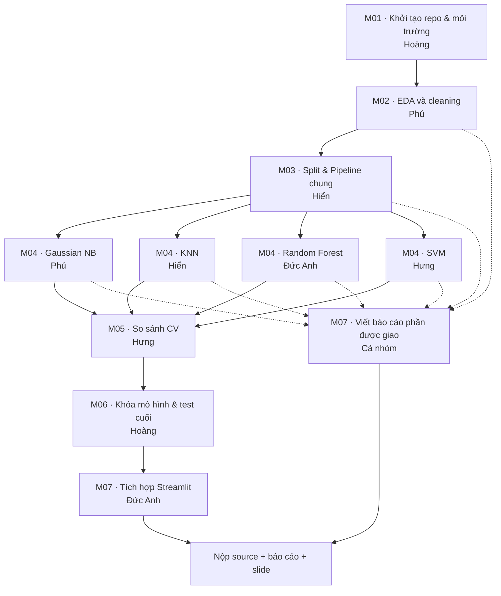

# ML&DM — THỐNG KÊ & LỘ TRÌNH TRIỂN KHAI DỰ ÁN

> **Mục đích:** Biến bảng phân công `ML_Work Progress` thành tài liệu làm việc chung có thể đưa thẳng vào repository GitHub: ai làm gì, thứ tự phụ thuộc, cách triển khai, đầu ra cần bàn giao và điều kiện hoàn thành.
>
> **Nguồn dữ liệu chính:** [ML_Work Progress — Google Sheets](https://docs.google.com/spreadsheets/d/1V-87ntJkZFIsZyDklNJ_GLVdoQDmgRDkxlzkMPPiXW4/edit), ba tab `Module`, `Task Assignment`, `Project Convention`, đọc ngày **17/11/2026**.
>
> **Quy ước nguồn:** Các phần đánh dấu **[Theo Sheet]** phản ánh kế hoạch đã có. Các phần đánh dấu **[Đề xuất triển khai]** là hướng dẫn bổ sung, **không phải quyết định đã được nhóm thống nhất**. Trạng thái trong tài liệu là ảnh chụp tại ngày lập; khi cập nhật, ưu tiên đồng bộ với Sheet gốc.

## 1. Bức tranh tổng quan

**[Theo Sheet]**

- **Tên dự án/repository:** `diabetes-classification`.
- **Bài toán:** phân loại nhị phân nguy cơ/tình trạng tiểu đường từ các chỉ báo sức khỏe, theo nhãn của phiên bản dữ liệu được chọn. *Diễn giải y=1 chính xác cần xác minh trong dataset thực tế; không mặc định là chẩn đoán y khoa.*
- **Dataset dự kiến:** [CDC Diabetes Health Indicators (UCI #891)](https://archive.ics.uci.edu/dataset/891/cdc+diabetes+health+indicators).
- **Cột nhãn dự kiến:** `Diabetes_binary`; đặc trưng là các cột đầu vào hợp lệ khác, loại trừ nhãn và biến gây rò rỉ.
- **4 mô hình:** Gaussian Naive Bayes (**Phú**), KNN (**Hiển**), Random Forest (**Đức Anh**), SVM tuyến tính và thử RBF (**Hưng**).
- **Người điều phối, review PR và đánh giá test cuối:** **Hoàng**.
- **Môi trường:** Python, Jupyter; ứng dụng demo dự kiến dùng Streamlit.
- **Quy trình:** làm sạch dữ liệu → chia train/test → preprocessing an toàn → CV/tuning → so sánh validation → *khóa cấu hình* → đánh giá test một lần → demo/báo cáo.

### 1.1. Tình trạng hiện tại — theo cột `Status`

| Chỉ số | Giá trị |
|---|---:|
| Tổng số module | **7** |
| Tổng số task | **45** |
| Số task hoàn thành (`TRUE`) | **0** |
| Số task chưa hoàn thành (`FALSE`) | **45** |
| Tỷ lệ hoàn thành | **0%** |
| Số người được phân công | **5** |

> **Lưu ý:** `FALSE` được diễn giải là **chưa tick hoàn thành trên Sheet**, không chứng minh rằng ngoài thực tế nhóm chưa bắt đầu. Chưa có cột ngày bắt đầu/hạn chót hoặc tiến độ phần trăm trong nguồn; tài liệu **không tự gán** ngày hẹn, nỗ lực hay mức độ hoàn thành từng người.

### 1.2. Khối lượng theo module

| Module | Người/nhóm chịu trách nhiệm | Task | Hoàn thành | Cổng bắt đầu (Gate) | Đầu ra cuối module |
|---|---|---:|---:|---|---|
| **M01 - Khởi tạo dự án** | Hoàng | 3 | 0/3 | Bắt đầu ngay | Repository GitHub có đầy đủ cấu trúc và hướng dẫn ban đầu. |
| **M02 - Khảo sát và làm sạch dữ liệu** | Phú | 4 | 0/4 | Sau M01 | Mã nguồn làm sạch, báo cáo khảo sát và mô tả các cột dữ liệu. |
| **M03 - Xây dựng pipeline xử lý dữ liệu** | Hiển | 5 | 0/5 | Sau M02 | Module preprocessing, cấu hình chia dữ liệu và hướng dẫn sử dụng. |
| **M04 - Huấn luyện và tối ưu mô hình** | Phú, Hiển, Đức Anh, Hưng | 16 | 0/16 | Sau M03 | Bốn notebook, bốn mô hình đã huấn luyện và bốn file kết quả đánh giá chéo. |
| **M05 - Tổng hợp và so sánh mô hình** | Hưng | 5 | 0/5 | Sau M04 | Bảng so sánh kết quả validation, biểu đồ và bản phân tích. |
| **M06 - Đánh giá cuối và chọn mô hình** | Hoàng | 4 | 0/4 | Sau M05 | Bảng đánh giá cuối cùng, kết luận và mô hình tốt nhất đã lưu. |
| **M07 - Demo và hoàn thiện báo cáo** | Đức Anh, Phú, Hiển, Hưng, Hoàng | 8 | 0/8 | Sau M06 đối với demo; các phần báo cáo có thể viết sớm hơn | Ứng dụng demo, báo cáo hoàn chỉnh, slide và source code bản nộp. |

### 1.3. Khối lượng theo người

| Thành viên | Số task được giao | Trách nhiệm xuyên suốt |
|---|---:|---|
| **Hoàng** | **8** | M01: hạ tầng Git; M06: chốt & test; M07: kết luận và review/tích hợp. |
| **Phú** | **9** | M02: dữ liệu/cleaning; M04: Gaussian NB; M07: báo cáo dữ liệu & NB. |
| **Hiển** | **10** | M03: split & preprocessing chung; M04: KNN; M07: báo cáo pipeline & KNN. |
| **Đức Anh** | **8** | M04: Random Forest; M07: demo Streamlit, báo cáo RF, tổng hợp bản nộp. |
| **Hưng** | **10** | M04: SVM; M05: tổng hợp CV và phân tích; M07: báo cáo SVM & so sánh. |

## 2. Sơ đồ phụ thuộc và các mốc bàn giao

**[Theo Sheet]** Các module chính phải đi qua các cổng trước khi downstream bắt đầu. **[Đề xuất triển khai]** Có thể nghiên cứu mô hình và soạn nháp báo cáo song song, nhưng **không huấn luyện chính thức** trước khi pipeline chung được nghiệm thu.



### 2.1. Definition of Done theo mốc (đề xuất)

| Cổng | Chỉ được đóng khi... | Người xác nhận |
|---|---|---|
| **G1 — Sau M01** | Cả nhóm clone repo, chạy được môi trường và quy tắc PR đã công bố. | Hoàng |
| **G2 — Sau M02** | Có dataset đúng phiên bản, data dictionary, báo cáo EDA, cleaning tái lập; file bàn giao hợp lệ. | Phú + Hiển |
| **G3 — Sau M03** | Split có phân tầng 80/20, seed 42, test giữ riêng; các mô hình gọi cùng interface; xử lý theo fold không bị leakage. | Hiển + Hoàng |
| **G4 — Sau M04** | Cả 4 mô hình có baseline, tuning theo 5-fold CV, notebook, fitted pipeline, `best_params`, `metrics.json` nhất quán. | 4 người + Hưng |
| **G5 — Sau M05** | Có `comparison_cv.csv`, biểu đồ, nhận xét ưu/nhược, khuyến nghị mô hình dựa trên validation (không dựa vào test). | Hưng + Hoàng |
| **G6 — Sau M06** | Quyết định cấu hình/ngưỡng đã lưu trước khi mở test; báo cáo test, ma trận nhầm lẫn, ROC/PR, FP/FN và `best_model.joblib`. | Hoàng |
| **G7 — Sau M07** | Demo chạy trên môi trường sạch; README, báo cáo, slide, source và minh chứng kết quả nhất quán. | Cả nhóm |

### 2.2. Các điểm nên làm song song (đề xuất)

- **Trong M01:** mọi người có thể đọc lý thuyết thuật toán; Phú chuẩn bị nguồn dataset *nhưng chưa thay thế việc chốt format bàn giao trong M02*.
- **Khi M02/M03 đang chạy:** 4 thành viên lập sẵn notebook giải thích phương pháp, các không gian hyperparameter dự kiến; chưa dùng test hay tự tạo preprocessing cạnh tranh.
- **Khi M04 đang chạy:** mỗi người viết ngay mục phương pháp và thí nghiệm của mình; không chờ M07 mới viết toàn bộ.
- **Khi M05/M06:** Đức Anh có thể dựng giao diện Streamlit bằng dữ liệu giả (mock) rồi thay bằng mô hình thật sau G6.

## 3. Khởi động ngay: thứ tự công việc ưu tiên

**[Đề xuất triển khai — không phải deadline từ Sheet]**

### Buổi 1 — Thiết lập nền tảng

1. **Hoàng (M01):** tạo repository `diabetes-classification`, thêm cây thư mục, `.gitignore`, `requirements.txt`/file khóa phiên bản, README hướng dẫn cài và chạy; mời Phú, Hiển, Đức Anh, Hưng.
2. **Hoàng:** công bố quy ước `main` chỉ nhận code qua Pull Request có review; tạo mẫu Issue/PR và task board đối chiếu 45 task ở mục 4.
3. **Cả nhóm:** clone repo, tạo virtual environment, cài dependencies và thử chạy một notebook đơn giản; báo lại khi hoạt động.
4. **Đầu ra để chuyển G1:** một commit nền tảng, hướng dẫn clone/cài chạy, phân quyền thành viên hoạt động.

### Ngay sau G1 — Chốt hợp đồng dữ liệu

1. **Phú (M02):** xác nhận đúng biến thể của bộ UCI #891, bản CSV được dùng, tên nhãn, ý nghĩa từng giá trị, các biến đầu vào và license/nguồn; không đoán chỉ từ tên dataset.
2. **Phú:** thống kê missing, duplicates, phân phối nhãn, kiểu dữ liệu và giá trị bất thường; ghi quy tắc xóa/sửa rõ ràng.
3. **Phú → Hiển:** bàn giao `cleaning.py`, dữ liệu đầu ra có schema ổn định và data dictionary; lý tưởng kèm test đơn giản cho cleaning.
4. **Hiển (M03):** thiết lập split phân tầng **80/20** với **seed 42**, giữ test hoàn toàn độc lập, sau đó khóa quy tắc preprocessing/CV chung.
5. **Hoàng:** duyệt G2/G3 rồi mới cho chạy bốn nhóm thí nghiệm chính thức.

### Sau G3 — Chạy baseline trước tuning

1. Mỗi người chạy baseline theo cùng split, cùng 5-fold StratifiedKFold trên **train 80%**, cùng định nghĩa metric, cùng output JSON.
2. Chốt baseline của **4** thuật toán, kiểm tra tính hợp lệ trước khi chạy GridSearchCV/RandomizedSearchCV.
3. Tối ưu hyperparameter trên training folds; lưu đầy đủ tham số, độ lệch CV, thời gian train và artefact để Hưng tổng hợp.

### Sau G4 — Chọn mô hình và đóng gói

1. **Hưng:** chuẩn hóa 4 file metrics, tạo bảng và biểu đồ so sánh CV, khuyến nghị ứng viên.
2. **Hoàng:** chốt *trước* mô hình/siêu tham số/ngưỡng, sau đó mới đánh giá test cuối và phân tích lỗi; lưu `best_model.joblib`.
3. **Đức Anh:** kết nối Streamlit tới pipeline đã fit; cả nhóm hoàn thiện báo cáo, slide và bundle nộp.

### Lịch gợi ý nếu nhóm muốn chia 4 đợt (không phải lịch cố định)

| Đợt | Trọng tâm | Điều kiện đạt |
|---|---|---|
| 1 | M01 + M02 | G1, G2 |
| 2 | M03 + baseline của M04 | G3, baseline chạy được |
| 3 | Tuning M04 + M05 | G4, G5 |
| 4 | M06 + M07 | G6, G7 |

> **Cảnh báo:** Đợt là thứ tự ưu tiên chứ không phải ấn định bốn tuần. Cần bổ sung deadline thực tế từ lịch nhóm/lịch môn học trước khi gắn ngày.

## 4. Toàn bộ checklist công việc — giữ nguyên phân công từ Sheet

**[Theo Sheet]** Các dòng dưới đây được chuyển trực tiếp từ `Task Assignment`, giữ nguyên thứ tự và người phụ trách. Mã `T01`–`T45` do tài liệu này bổ sung để tiện mở GitHub Issue (không phải ID gốc). Trạng thái ban đầu được lấy từ cột `Status`: **45/45 chưa đánh dấu hoàn thành**.

### M01 — Khởi tạo dự án (3 task)

**Chủ trì:** Hoàng  
**Điều kiện bắt đầu:** Bắt đầu ngay  
**Bàn giao theo Sheet:** Repository GitHub có đầy đủ cấu trúc và hướng dẫn ban đầu.

- [ ] **T01 · Hoàng:** Khởi tạo GitHub repository, cấu trúc thư mục và README ban đầu
- [ ] **T02 · Hoàng:** Thiết lập môi trường Python/Jupyter, requirements.txt và .gitignore
- [ ] **T03 · Hoàng:** Mời thành viên vào repo, tạo quy ước branch và Pull Request

### M02 — Khảo sát và làm sạch dữ liệu (4 task)

**Chủ trì:** Phú  
**Điều kiện bắt đầu:** Sau M01  
**Bàn giao theo Sheet:** Mã nguồn làm sạch, báo cáo khảo sát và mô tả các cột dữ liệu.

- [ ] **T04 · Phú:** Chốt dataset, cột nhãn và danh sách đặc trưng đầu vào
- [ ] **T05 · Phú:** Khảo sát phân bố nhãn, dữ liệu thiếu, dữ liệu trùng và giá trị bất thường
- [ ] **T06 · Phú:** Xây dựng quy tắc làm sạch và xử lý những bản ghi không hợp lệ
- [ ] **T07 · Phú:** Viết cleaning.py, tài liệu mô tả dữ liệu và bàn giao cho Hiển

### M03 — Xây dựng pipeline xử lý dữ liệu (5 task)

**Chủ trì:** Hiển  
**Điều kiện bắt đầu:** Sau M02  
**Bàn giao theo Sheet:** Module preprocessing, cấu hình chia dữ liệu và hướng dẫn sử dụng.

- [ ] **T08 · Hiển:** Tiếp nhận dữ liệu đã làm sạch, kiểm tra schema và cột đầu vào
- [ ] **T09 · Hiển:** Xây dựng hàm chia train/test có phân tầng, tỷ lệ 80/20, seed 42
- [ ] **T10 · Hiển:** Xây dựng preprocessing.py: điền thiếu, mã hóa và chuẩn hóa tùy mô hình
- [ ] **T11 · Hiển:** Thiết lập StratifiedKFold 5 fold, Pipeline và kiểm tra data leakage
- [ ] **T12 · Hiển:** Thống nhất API preprocessing, cấu hình và mẫu metrics.json cho nhóm

### M04 — Huấn luyện và tối ưu mô hình (16 task)

**Chủ trì:** Phú, Hiển, Đức Anh, Hưng  
**Điều kiện bắt đầu:** Sau M03  
**Bàn giao theo Sheet:** Bốn notebook, bốn mô hình đã huấn luyện và bốn file kết quả đánh giá chéo.

- [ ] **T13 · Phú:** Nghiên cứu nguyên lý và giả định Gaussian Naive Bayes
- [ ] **T14 · Hiển:** Nghiên cứu KNN và các độ đo khoảng cách
- [ ] **T15 · Đức Anh:** Nghiên cứu Decision Tree, Bagging và Random Forest
- [ ] **T16 · Hưng:** Nghiên cứu Linear SVM, Kernel SVM và margin
- [ ] **T17 · Phú:** Huấn luyện baseline Gaussian Naive Bayes bằng pipeline chung
- [ ] **T18 · Hiển:** Huấn luyện baseline KNN bằng pipeline chung
- [ ] **T19 · Đức Anh:** Huấn luyện baseline Random Forest bằng pipeline chung
- [ ] **T20 · Hưng:** Huấn luyện baseline Linear SVM và thử RBF SVM bằng pipeline chung
- [ ] **T21 · Phú:** Tối ưu var_smoothing bằng cross-validation
- [ ] **T22 · Hiển:** Tối ưu n_neighbors, weights và metric bằng cross-validation
- [ ] **T23 · Đức Anh:** Tối ưu n_estimators, max_depth, min_samples_leaf và max_features
- [ ] **T24 · Hưng:** Tối ưu kernel, C, gamma và class_weight bằng cross-validation
- [ ] **T25 · Phú:** Xuất notebook, fitted pipeline, best_params và metrics.json của Naive Bayes
- [ ] **T26 · Hiển:** Xuất notebook, fitted pipeline, best_params và metrics.json của KNN
- [ ] **T27 · Đức Anh:** Xuất notebook, fitted pipeline, best_params và metrics.json của Random Forest
- [ ] **T28 · Hưng:** Xuất notebook, fitted pipeline, best_params và metrics.json của SVM

### M05 — Tổng hợp và so sánh mô hình (5 task)

**Chủ trì:** Hưng  
**Điều kiện bắt đầu:** Sau M04  
**Bàn giao theo Sheet:** Bảng so sánh kết quả validation, biểu đồ và bản phân tích.

- [ ] **T29 · Hưng:** Kiểm tra cấu trúc và tính nhất quán của bốn file metrics.json
- [ ] **T30 · Hưng:** Tổng hợp bảng so sánh Accuracy, Precision, Recall, F1, ROC-AUC và AP từ cross-validation
- [ ] **T31 · Hưng:** Tạo biểu đồ so sánh kết quả validation và thời gian huấn luyện các mô hình
- [ ] **T32 · Hưng:** Phân tích ưu nhược điểm, độ ổn định và đề xuất mô hình tiềm năng
- [ ] **T33 · Hưng:** Bàn giao comparison_cv.csv, biểu đồ và nhận xét cho Hoàng

### M06 — Đánh giá cuối và chọn mô hình (4 task)

**Chủ trì:** Hoàng  
**Điều kiện bắt đầu:** Sau M05  
**Bàn giao theo Sheet:** Bảng đánh giá cuối cùng, kết luận và mô hình tốt nhất đã lưu.

- [ ] **T34 · Hoàng:** Dựa trên kết quả validation để chốt mô hình, hyperparameters và ngưỡng dự đoán
- [ ] **T35 · Hoàng:** Đánh giá các cấu hình đã chốt trên tập test giữ riêng
- [ ] **T36 · Hoàng:** Tạo confusion matrix, ROC/PR và phân tích False Positive, False Negative trên test
- [ ] **T37 · Hoàng:** Kết luận lựa chọn mô hình và bàn giao best_model.joblib cho Đức Anh

### M07 — Demo và hoàn thiện báo cáo (8 task)

**Chủ trì:** Đức Anh, Phú, Hiển, Hưng, Hoàng  
**Điều kiện bắt đầu:** Sau M06 đối với demo; các phần báo cáo có thể viết sớm hơn  
**Bàn giao theo Sheet:** Ứng dụng demo, báo cáo hoàn chỉnh, slide và source code bản nộp.

- [ ] **T38 · Đức Anh:** Xây dựng ứng dụng Streamlit để nhập thông tin và nhận kết quả dự đoán
- [ ] **T39 · Đức Anh:** Tích hợp best_model.joblib và kiểm tra luồng dự đoán của ứng dụng
- [ ] **T40 · Phú:** Viết báo cáo và slide phần dữ liệu và Naive Bayes
- [ ] **T41 · Hiển:** Viết báo cáo và slide phần preprocessing và KNN
- [ ] **T42 · Đức Anh:** Viết báo cáo và slide phần Random Forest và demo
- [ ] **T43 · Hưng:** Viết báo cáo và slide phần SVM và so sánh validation
- [ ] **T44 · Hoàng:** Viết phần kết luận đánh giá mô hình cuối cùng
- [ ] **T45 · Đức Anh:** Tổng hợp báo cáo PDF, slide, README hướng dẫn chạy và source code bản nộp

## 5. Chuẩn kỹ thuật đã thống nhất trong Project Convention

**[Theo Sheet]** Bảng sau sao chép đủ các trường quy ước của tab `Project Convention`. Đây là nguồn ưu tiên khi các notebook hoặc code nhánh khác nhau chưa đồng nhất.

| Nhóm | Trường | Giá trị quy ước | Giải thích / ghi chú gốc |
|---|---|---|---|
| Project | `project_name` | diabetes-classification | Tên dự án và repository GitHub. |
| Dataset | `dataset` | CDC Diabetes Health Indicators<br>https://archive.ics.uci.edu/dataset/891/cdc+diabetes+health+indicators | Bộ dữ liệu dự kiến sử dụng; phải thống nhất đúng phiên bản. |
| Dataset | `dataset_path` | data/raw/diabetes.csv | Đường dẫn tương đối tới dataset gốc trong project. |
| Dataset | `target_column` | Diabetes_binary | Tên cột nhãn cần phân loại; kiểm tra theo file CSV thực tế. |
| Dataset | `positive_label` | 1 | Lớp dương tính; cần mô tả chính xác ý nghĩa nhãn theo phiên bản dataset. |
| Dataset | `feature_columns` | Tất cả cột đầu vào hợp lệ, trừ target | Danh sách đặc trưng X; loại bỏ các cột gây rò rỉ nhãn nếu có. |
| Data Split | `test_size` | 0.2 (20%) | Giữ 20% dữ liệu để đánh giá cuối cùng, không dùng để tuning. |
| Data Split | `train_size` | 0.8 (80%) | Dữ liệu dành cho training và cross-validation. |
| Data Split | `stratify` | y | Giữ tỷ lệ các lớp tương đối đồng đều giữa train và test. |
| Data Split | `random_state` | 42 | Seed thống nhất để kết quả chia dữ liệu có thể tái lập. |
| Validation | `cv_strategy` | StratifiedKFold | Phương pháp chia các fold có phân tầng theo nhãn. |
| Validation | `cv_folds` | 5 | Chia training set thành 5 fold để huấn luyện và đánh giá chéo. |
| Preprocessing | `missing_values` | Theo quy tắc cleaning chung | Xử lý dữ liệu thiếu; tham số imputation chỉ được học trên training fold. |
| Preprocessing | `encoding` | Theo kiểu dữ liệu | Mã hóa đặc trưng phân loại khi cần; không đưa target vào X. |
| Preprocessing | `scaling` | StandardScaler cho KNN/SVM khi phù hợp | Mô hình cần chuẩn hóa sẽ dùng scaler trong Pipeline; Random Forest thường không cần. |
| Preprocessing | `data_leakage` | Không fit trên test | Không dùng dữ liệu test hoặc validation fold để học tham số tiền xử lý. |
| Training | `baseline` | Default model | Mỗi thuật toán phải có thí nghiệm ban đầu trước khi tuning. |
| Training | `hyperparameter_tuning` | GridSearchCV / RandomizedSearchCV | Tìm cấu hình tốt trên training set bằng cross-validation. |
| Training | `primary_metric` | average_precision | Metric chính đề xuất khi dữ liệu mất cân bằng; Recall/F1 của lớp 1 cũng phải được phân tích. |
| Training | `decision_threshold` | Baseline mặc định, tuning trên validation nếu cần | Ngưỡng quyết định không được tối ưu trên test set. |
| Evaluation | `metrics` | Accuracy, Precision, Recall, F1, ROC-AUC, AP | Bộ chỉ số chung để tất cả thuật toán báo cáo theo cùng định nghĩa. |
| Evaluation | `test_policy` | Final evaluation only | Chỉ dùng test cuối sau khi chốt mô hình, hyperparameters và threshold. |
| Output | `model_artifact` | model.joblib | Pipeline đã fit, bao gồm preprocessing và estimator. |
| Output | `metrics_file` | metrics.json | File kết quả có cùng cấu trúc giữa các module. |
| Output | `notebook` | *.ipynb | Mã thực nghiệm, biểu đồ và giải thích của từng thành viên. |
| Output | `result_figures` | results/figures/ | Thư mục chứa biểu đồ hoặc confusion matrix. |
| Git | `main_branch` | main | Nhánh tích hợp chính, không push trực tiếp. |
| Git | `feature_branch` | feature/<name>-<model> | Mỗi thành viên làm trên branch riêng. |
| Git | `merge_policy` | Pull Request + Review | Hoàng review PR trước khi merge vào main. |

## 6. Cấu trúc repository nên dùng

**[Đề xuất triển khai]** Cây sau **không phải cấu trúc đã ghi sẵn trong Sheet**. Nó cụ thể hóa đầu ra của M01–M07, được phép điều chỉnh nếu nhóm thống nhất.

```text
diabetes-classification/
├── README.md
├── requirements.txt
├── .gitignore
├── .github/
│   └── pull_request_template.md
├── configs/
│   └── experiment.yaml                # seed, CV, test_ratio, metric
├── data/
│   ├── raw/
│   │   └── diabetes.csv               # tên file chuẩn; không bắt buộc commit CSV
│   └── processed/                     # kết quả cleaning nếu cần lưu
├── docs/
│   ├── ML_DM_Implementation_Roadmap.md
│   ├── data_dictionary.md
│   ├── decisions.md                   # log quyết định và các thay đổi
│   └── report/                        # bản thảo/bản nộp
├── src/
│   ├── __init__.py
│   ├── cleaning.py                     # M02 - Phú
│   ├── preprocessing.py                # M03 - Hiển
│   ├── data_split.py                   # M03 - Hiển
│   ├── evaluation.py                   # metrics dùng chung
│   └── models/
│       ├── naive_bayes.py              # M04 - Phú
│       ├── knn.py                      # M04 - Hiển
│       ├── random_forest.py            # M04 - Đức Anh
│       └── svm.py                      # M04 - Hưng
├── notebooks/
│   ├── 00_eda.ipynb
│   ├── 01_naive_bayes.ipynb
│   ├── 02_knn.ipynb
│   ├── 03_random_forest.ipynb
│   └── 04_svm.ipynb
├── results/
│   ├── metrics/
│   ├── figures/
│   └── comparison_cv.csv
├── artifacts/
│   └── best_model.joblib               # M06 → M07
├── app/
│   └── streamlit_app.py                # M07 - Đức Anh
├── scripts/
│   ├── train.py
│   └── evaluate_test.py                # chỉ chạy theo quy trình M06
└── tests/
    ├── test_cleaning.py
    └── test_preprocessing.py
```

**Quy tắc tổ chức dữ liệu đề xuất:** không commit dataset thô dung lượng lớn hoặc dữ liệu nhạy cảm; ghi URL/phiên bản/checksum và hướng dẫn tải trong README. Nếu dùng file `data/raw/diabetes.csv` cục bộ, `.gitignore` cần được cấu hình để không đẩy nhầm dữ liệu.

### 6.1. Thiết lập môi trường tham khảo

```bash
# Windows PowerShell: python -m venv .venv; .venv\Scripts\Activate.ps1
# macOS/Linux:
python -m venv .venv
source .venv/bin/activate

python -m pip install --upgrade pip
pip install -r requirements.txt
python -m jupyter lab
```

**Gói Python đề xuất:** `numpy`, `pandas`, `scikit-learn`, `joblib`, `matplotlib`, `jupyterlab`, `streamlit`. Sau khi thử nghiệm, cố định phiên bản tương thích trong `requirements.txt` để bạn khác chạy tái lập được. Không tự hiểu đây là danh sách dependency đã được chốt bởi Sheet.

### 6.2. Workflow Git nhóm

**[Theo Sheet]** `main` là nhánh tích hợp; thành viên dùng branch `feature/<name>-<model>`, tạo Pull Request, Hoàng review trước merge. **[Đề xuất]** Ví dụ:

```bash
git checkout main
git pull origin main
git checkout -b feature/phu-naive-bayes
# chỉnh sửa, kiểm tra và commit
git add .
git commit -m "feat: add GaussianNB baseline"
git push -u origin feature/phu-naive-bayes
# Tạo Pull Request trên GitHub, không push thẳng main
```

**Checklist PR:** nêu task ID; mục đích; file thay đổi; cách chạy; bằng chứng chạy/tests; thay đổi interface hay metric; ảnh hoặc artifact nếu có; xác nhận không dùng test để tuning; reviewer duyệt trước merge.

## 7. Hợp đồng bàn giao kỹ thuật giữa các module

**[Đề xuất triển khai]** Định nghĩa giao diện thống nhất để M02, M03, M04 làm việc độc lập mà vẫn ghép được code.

### 7.1. Phú → Hiển: data contract (M02 → M03)

- Giao dataset sạch hoặc hàm tái lập quá trình làm sạch từ `data/raw/diabetes.csv`.
- Lưu data dictionary: tên cột, dtype, khoảng giá trị, ý nghĩa các mã, nhãn dương/âm, quy tắc xử lý missing/duplicate/outlier.
- **Không** thực hiện `fit` StandardScaler, imputer hay encoder dựa trên toàn dataset ở M02. Những phép học tham số này phải nằm trong train/CV pipeline của M03.
- Ghi rõ số bản ghi trước/sau cleaning và lí do loại/sửa, tránh xóa mẫu có hệ thống mà không giải thích.

### 7.2. Hiển → 4 người huấn luyện: API contract (M03 → M04)

- Một split duy nhất: **train 80%**, **test 20%**, `stratify=y`, `random_state=42`.
- Dùng `StratifiedKFold(n_splits=5, shuffle=True, random_state=42)` **trên train**.
- Mọi khâu imputation/encoding/scaling có `fit` phải đặt **bên trong `sklearn.pipeline.Pipeline` hoặc `ColumnTransformer`** và chạy trong từng fold; không fit bằng test hoặc validation fold.
- SVM/KNN áp dụng `StandardScaler` khi phù hợp; RF thường không cần chuẩn hóa; lựa chọn preprocess riêng từng mô hình nhưng dựa trên **cùng contract dữ liệu, split và đánh giá**.
- Cùng metric definitions: `Accuracy`, `Precision(1)`, `Recall(1)`, `F1(1)`, `ROC-AUC`, `Average Precision` (AP); AP là metric chính theo Sheet.
- Giao một interface huấn luyện/đánh giá và một **schema `metrics.json` thống nhất** trước khi từng người bắt đầu xuất kết quả.

**Sơ đồ tránh data leakage:**

```text
Dữ liệu sạch (chỉ các quy tắc cleaning độc lập với phép fit)
    └── Train 80% + Test 20% (stratify, seed=42)
          ├── Train: 5-fold Stratified CV
          │     ├── mỗi fold: fit preprocessing trên train-fold
          │     ├── mỗi fold: fit model trên train-fold
          │     └── mỗi fold: đánh giá trên validation-fold
          └── Test: niêm phong đến M06
```

### 7.3. Mỗi chủ mô hình → Hưng: model result contract (M04 → M05)

Tối thiểu cần giao:

1. `notebooks/<model>.ipynb` có baseline, search space, tham số chọn, biểu đồ và giải thích.
2. `artifacts/<model>.joblib` hoặc đường dẫn tương đương, là **fitted pipeline** chứa cả tiền xử lý và estimator.
3. `results/metrics/<model>.json` có metrics CV cùng schema, cùng mức đánh giá, mean/std nếu có.
4. `best_params` và nhật ký chạy (seed, số fold, thời gian, phiên bản thư viện/dataset).
5. Không dùng chỉ số test để so sánh hoặc xếp hạng mô hình trong M04/M05.

**Template đề xuất cho `metrics.json`** (số là placeholder, *không phải kết quả thật*):

```json
{
  "model_name": "gaussian_nb",
  "dataset_version": "TO_CONFIRM",
  "target_column": "Diabetes_binary",
  "positive_label": 1,
  "train_test_split": {"test_size": 0.2, "stratify": true, "random_state": 42},
  "cv": {"strategy": "StratifiedKFold", "folds": 5, "shuffle": true, "random_state": 42},
  "selection_metric": "average_precision",
  "baseline": {"average_precision_mean": null},
  "best_params": {},
  "validation_cv": {
    "accuracy_mean": null, "accuracy_std": null,
    "precision_mean": null, "precision_std": null,
    "recall_mean": null, "recall_std": null,
    "f1_mean": null, "f1_std": null,
    "roc_auc_mean": null, "roc_auc_std": null,
    "average_precision_mean": null, "average_precision_std": null
  },
  "training_time_seconds": null,
  "pipeline_path": "artifacts/gaussian_nb.joblib"
}
```

**Khi đánh giá ROC-AUC/AP:** sử dụng điểm liên tục (`predict_proba` hoặc `decision_function` phù hợp), **không** dùng nhãn 0/1 đã ngưỡng hóa. Nếu một thuật toán không cung cấp thang điểm tương đương xác suất, ghi rõ cách tạo score và giới hạn diễn giải. Không thay `null` bằng số tự nghĩ.

### 7.4. Hưng → Hoàng: bảng so sánh (M05 → M06)

- `results/comparison_cv.csv`: mỗi hàng là một mô hình hoặc cấu hình ứng viên; cột có Accuracy, Precision, Recall, F1, ROC-AUC, AP, thời gian train, và độ biến thiên CV.
- Biểu đồ từ **validation** (`results/figures/`) và nhận xét về trade-off AP/Recall/Precision, mức ổn định, tốc độ, khả năng triển khai.
- Đề xuất ứng viên và lý do chọn; **không nhìn vào test**.

### 7.5. Hoàng → Đức Anh: model deploy contract (M06 → M07)

- Chốt và ghi log `model_name`, `best_params`, `decision_threshold` (nếu tinh chỉnh) **trước** đánh giá test cuối.
- Chỉ sau đó mới chạy đánh giá test; lưu confusion matrix, ROC/PR, FP/FN và bảng chỉ số cuối.
- Bàn giao `best_model.joblib` là **fitted pipeline** để Streamlit nhận đúng schema đầu vào và gọi `predict`/`predict_proba` hoặc scorer tương ứng.
- Demo hiển thị đây là **kết quả dự đoán của mô hình trên dữ liệu**, không phải kết luận/chẩn đoán y tế.

## 8. Hướng dẫn thực hiện từng thuật toán (khung chung)

**[Theo Sheet: phân công và tham số] + [Đề xuất: trình tự làm việc]**

| Thành viên | Thuật toán | Baseline | Tham số cần thử theo Sheet | Điều cần trình bày |
|---|---|---|---|---|
| **Phú** | Gaussian Naive Bayes | `GaussianNB()` | `var_smoothing` | Giả định phân phối Gaussian và giới hạn giả định độc lập. |
| **Hiển** | KNN | `KNeighborsClassifier()` | `n_neighbors`, `weights`, `metric` | Khoảng cách, ảnh hưởng chuẩn hóa và chi phí dự đoán. |
| **Đức Anh** | Random Forest | `RandomForestClassifier()` | `n_estimators`, `max_depth`, `min_samples_leaf`, `max_features` | Decision Tree, Bagging, bias/variance, feature importance nếu phù hợp. |
| **Hưng** | Linear SVM; thử RBF | `SVC(kernel="linear")` hoặc `LinearSVC` (ghi rõ lựa chọn) | `kernel`, `C`, `gamma`, `class_weight` | Margin, kernel và sự khác nhau giữa linear/RBF, chi phí tính toán. |

**Mỗi người chạy đúng trình tự:** (1) hiểu dữ liệu và label → (2) baseline bằng pipeline chung → (3) CV baseline → (4) search hyperparameters trên training folds → (5) xuất kết quả CV theo schema → (6) bàn giao PR/notebook/joblib/JSON. Nếu cần chỉnh class weight hoặc threshold, ghi thành một thí nghiệm có lý do, không thay quy ước chung âm thầm.

### Lưu ý riêng về threshold

- **[Theo Sheet]** Ngưỡng mặc định là baseline; có thể điều chỉnh dựa trên validation, **không** tuning trên test.
- **[Đề xuất]** Khi muốn tối ưu threshold, dùng out-of-fold validation scores hoặc một cách chia validation riêng được công bố; khóa threshold trước M06 và ghi quy tắc rõ ràng để tránh ưu tiên quá mức trên cùng dữ liệu.
- Chọn threshold phải gắn với mục tiêu: Recall lớp 1 (giảm bỏ sót), Precision lớp 1 (giảm cảnh báo nhầm), AP để so sánh khả năng xếp hạng. Không mặc định một metric đủ đại diện cho mọi mục tiêu.

## 9. Kiểm định, báo cáo và nghiệm thu

### 9.1. Checklist kiểm định code

- [ ] Toàn nhóm dùng cùng một dataset version/hash, target, feature schema, split và seed.
- [ ] Không có target hoặc cột hậu nghiệm gây rò rỉ nhãn trong `X`.
- [ ] Test set không bị fit, không dùng để tuning, không tham gia chọn mô hình.
- [ ] Tất cả biến đổi có `fit` được gọi trong training fold qua `Pipeline`.
- [ ] 4 mô hình có baseline trước tuning, 5-fold CV, metric chính AP và bộ 6 metrics đầy đủ.
- [ ] `metrics.json` ở cả 4 mô hình cùng schema, cùng định nghĩa positive label.
- [ ] `best_model.joblib` có thể load và predict từ đầu vào đúng schema (không phụ thuộc biến notebook).
- [ ] Repo clone sạch có thể cài thư viện, tải/đọc dữ liệu theo hướng dẫn và tái chạy thí nghiệm.
- [ ] Các biểu đồ/table trong báo cáo khớp với file kết quả, không trộn CV và test.
- [ ] Streamlit có thông báo lỗi input và không đưa ra kết luận y khoa quá mức.

### 9.2. Bộ sản phẩm phải có khi nộp

**[Theo Sheet]**

| Sản phẩm | Đơn vị thực hiện chính | Tiêu chí kiểm tra |
|---|---|---|
| Source, notebook, code cleaning/preprocessing | Hoàng + từng chủ phần | Có cấu trúc và chạy lại được. |
| 4 mô hình + 4 bộ `metrics.json` + `best_params` | Phú, Hiển, Đức Anh, Hưng | Cùng quy ước và có baseline/tuning. |
| `comparison_cv.csv` + biểu đồ | Hưng | So sánh trên CV/training validation. |
| `best_model.joblib` + test metrics/figures | Hoàng | Kết quả test sau khi khóa quyết định. |
| Demo Streamlit | Đức Anh | Nhập thông tin, nhận dự đoán, không sai schema. |
| Các phần báo cáo, slide theo phân công | Cả nhóm | Có số liệu, phương pháp, hạn chế, phân công minh bạch. |
| Bản PDF/slide/README/source cuối | Đức Anh tổng hợp; cả nhóm rà soát | Phù hợp hướng dẫn chạy và demo. |

**[Tham chiếu thêm: `Course-Intro.pdf`, trang 7–11, ngoài bảng Work Progress]** Đồ án môn IT3190 yêu cầu trình bày cuối môn, **cả nhóm cùng tham gia**, nộp source code dưới dạng file nén, hướng dẫn chạy (`readme.txt`) và báo cáo PDF. Bài trình bày khoảng **12 phút**; cần nêu rõ mã nguồn/công cụ kế thừa. Vì Sheet đang ghi `README`, khi đóng gói nên kèm `readme.txt` theo yêu cầu môn học hoặc xác nhận giảng viên có chấp nhận `README.md` thay thế hay không.

### 9.3. Khung báo cáo đề xuất

1. Bài toán thực tế và mục tiêu/ý nghĩa nhãn, giới hạn sử dụng.
2. Giới thiệu dataset, phiên bản, thống kê, phân phối nhãn, dữ liệu thiếu/ngoại lai, cleaning.
3. Thiết kế train/test split, pipeline, chống leakage, cross-validation và metric.
4. Phương pháp Gaussian NB, KNN, Random Forest, SVM; cấu hình baseline và tuning.
5. Bảng/biểu đồ so sánh kết quả CV, lý do chọn mô hình.
6. Kết quả test cuối sau khi chốt model, confusion matrix, ROC/PR, FP/FN và phân tích lỗi.
7. Mô tả demo Streamlit, kiến trúc module, giao diện/chức năng/hướng dẫn chạy.
8. Khó khăn, giới hạn, nguồn code/thư viện kế thừa, công việc từng thành viên và hướng phát triển.

## 10. Rủi ro, quyết định cần chốt và nhật ký thay đổi

**[Các vấn đề chưa được xác định dứt điểm từ Sheet; không nên tự suy diễn]**

| ID | Vấn đề / rủi ro | Hành động cần thực hiện | Chủ trì gợi ý |
|---|---|---|---|
| **D01** | UCI #891 có thể có nhiều bảng/biến thể; tên `Diabetes_binary` phải khớp CSV. | Chốt file/phiên bản, nhãn, schema và checksum trong data dictionary. | Phú |
| **D02** | Tỷ lệ lớp dương có thể mất cân bằng; accuracy dễ che vấn đề. | Xác nhận phân phối thật, thống nhất AP chính, báo cáo Recall/Precision/F1 lớp 1. | Phú + Hiển |
| **D03** | Làm sạch trước split có nguy cơ leakage nếu dùng thống kê toàn bộ dữ liệu. | Phân biệt quy tắc sửa lỗi độc lập với tham số học từ dữ liệu; impute/encode/scale trong Pipeline fold. | Phú + Hiển |
| **D04** | Khác nhau về `metrics.json` và interface khiến Hưng không tổng hợp được. | Duyệt template chung và PR pipeline trước M04. | Hiển + Hưng |
| **D05** | Không thống nhất cách tạo score SVM cho ROC-AUC/AP/demo. | Ghi rõ estimator, score API và liệu có calibration không. | Hưng + Đức Anh |
| **D06** | Chọn model/threshold theo test gây lạc quan giả. | Niêm phong test; chốt tham số/ngưỡng và log quyết định trước khi Hoàng mở test. | Hoàng |
| **D07** | Chưa có deadline/ngày check-in trong Sheet. | Bổ sung deadline, kỳ review, mức ưu tiên trong GitHub Issues hoặc Sheet sau khi nhóm thống nhất. | Hoàng + cả nhóm |
| **D08** | Streamlit dễ lỗi do schema/cách encoding khác notebook. | Export **cả fitted Pipeline**, dùng dữ liệu mẫu kiểm thử đầu-cuối. | Đức Anh + Hiển |

### Mẫu Decision Log (đề xuất)

```markdown
## DEC-001: [Tên quyết định]
- Ngày: YYYY-MM-DD
- Người đề xuất:
- Vấn đề:
- Các phương án:
- Quyết định:
- Lý do & dữ liệu hỗ trợ:
- Phần code/file bị ảnh hưởng:
- Người duyệt:
```

### Mẫu cập nhật tiến độ mỗi buổi check-in (đề xuất)

```markdown
- Thành viên:
- Task: Txx
- Trạng thái: Todo / In Progress / Blocked / Done
- Đã làm: [link PR/commit/notebook]
- Vấn đề hoặc phụ thuộc:
- Bàn giao tiếp theo:
- ETA: [chỉ điền khi đã tự xác nhận]
```

> **Quy tắc cập nhật:** Khi một PR được merge và đạt tiêu chí nghiệm thu, cập nhật `Status = TRUE` trên tab `Task Assignment` tương ứng. Không đánh dấu Done chỉ vì đã có notebook nhưng chưa chạy/được review.

## 11. Checklist của người điều phối (Hoàng)

- [ ] Khởi tạo repo, mời đúng 4 thành viên, publish quy ước Git/PR (M01).
- [ ] Tạo Issue từ `T01`–`T45` và gắn mỗi Issue cho đúng thành viên.
- [ ] Check G2: dataset, nhãn, EDA và cleaning của Phú đã ổn định.
- [ ] Check G3: Hiển bàn giao split, Pipeline, schema metrics và kiểm tra leakage.
- [ ] Kiểm tra cả 4 mô hình xuất baseline + tuning + JSON đầy đủ (G4).
- [ ] Review bảng CV và khuyến nghị của Hưng; ghi lý do chọn mô hình (G5).
- [ ] **Khóa model/hyperparameters/threshold trước khi test**; chỉ sau đó đánh giá test (G6).
- [ ] Bàn giao file `best_model.joblib` và feature schema cho Đức Anh.
- [ ] Kiểm tra bản nộp, demo, tài liệu, slide và bài nói của toàn nhóm (G7).

---

## 12. Cách dùng tài liệu này trong dự án

1. Đưa file này vào `docs/ML_DM_Implementation_Roadmap.md` và thêm liên kết từ README gốc.
2. Giữ Sheet `ML_Work Progress` là **nguồn cập nhật trạng thái**; checklist tại đây là snapshot và danh sách kiểm tra ban đầu.
3. Tạo GitHub Issues dựa trên `T01`–`T45`; gắn Pull Request tương ứng.
4. Thực hiện đúng các gate, không bỏ qua nghiệm thu `M02 → M03` và `M03 → M04`.
5. Khi thay đổi dataset, nhãn, metric, split, version hoặc API, ghi vào `docs/decisions.md` và thông báo cả nhóm trước khi merge.

**Nguồn tham chiếu:**
- [ML_Work Progress — Module, Task Assignment, Project Convention](https://docs.google.com/spreadsheets/d/1V-87ntJkZFIsZyDklNJ_GLVdoQDmgRDkxlzkMPPiXW4/edit)
- [CDC Diabetes Health Indicators — UCI #891](https://archive.ics.uci.edu/dataset/891/cdc+diabetes+health+indicators) *(đường dẫn kế hoạch, chưa khẳng định biến thể CSV thực tế)*
- `Course-Intro.pdf` (trang 7–11: yêu cầu đồ án, đánh giá, nộp bài và trình bày)

*Tài liệu được dựng lại từ Sheet hiện có, không thay đổi Sheet gốc.*
